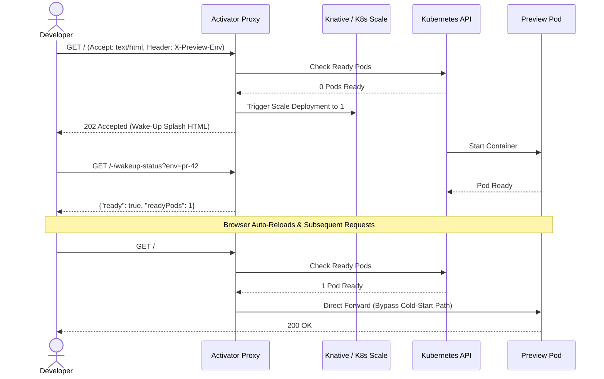

Preview environments are incredibly powerful, but they can be expensive if they run 24/7. Most pull requests are reviewed intermittently—a few minutes of activity followed by hours or days of idle time.

Diverge solves this by allowing your preview environments to **scale to zero** when they aren't receiving traffic.

## Why Scale-to-Zero Matters

- **Massive Cost Savings**: 50 PRs with always-on pods cost ~$1,200/month. With Knative scale-to-zero, that same workload costs ~$15/month *(illustrative estimate based on 50 always-on pods vs. ~3 concurrently active)*.
- **Resource Efficiency**: Fit hundreds of preview environments on a small cluster.
- **Fast Startup**: Previews wake up automatically when a reviewer opens them (startup is typically ~5 seconds, but varies with image size, scheduling, and readiness probe configuration). The Activator buffers requests during startup, though requests may time out if pod startup exceeds the client or proxy request timeout.

## How It Works

Diverge integrates with **Knative Serving** and its own **Activator Proxy** to manage the lifecycle of your pods:

1. **Idle Detection**: Knative monitors traffic to your preview services. When no requests arrive for a configurable period, Knative scales the deployment down to 0 replicas.
2. **Wake Up Flow**: When a new request arrives, it hits the Activator Proxy.
3. **Queue & Scale**: The proxy holds the request, triggers a scale-up of the service to 1 (or more) replicas, and waits for the pod to become ready.
4. **Forward**: Once ready, the proxy forwards the queued request to the newly running pod. Subsequent requests go directly to the pod.

### The Activator Proxy

The **Activator Proxy** (`activator-proxy`) is a specialized binary that sits in front of preview environments. 

- **Smart Routing**: Routes to ready pods directly when available to minimize latency.
- **Fallback to Knative / Scale-Up**: If pods are scaled to zero, it triggers a scale-up of the deployment (or falls back to the Knative/KEDA activator) to wake the service.
- **Preview Wake-Up Splash Page (`--wake-splash`)**: Serves an auto-refreshing `202 Accepted` HTML splash screen to browsers during cold starts instead of hanging the browser tab, while keeping API/programmatic clients buffered transparently.
- **Header Injection**: Injects the `X-Preview-Env` header to ensure routing rules continue to work.
- **Efficient State Tracking**: Uses a shared informer to efficiently track pod states across the cluster.

## Preview Wake-Up Splash Page (`--wake-splash`)

When a reviewer clicks a preview URL in a browser while the preview pod is scaled to zero, waiting several seconds on a blank loading spinner can feel broken.

The `activator-proxy` supports an opt-in **Wake-Up Splash Page** (enabled by default with `--wake-splash=true`):

1. **Browser Detection**: When all pods for the target preview environment are scaled to zero (`0` ready pods) and the incoming request is a browser navigation (`GET` or `HEAD` with `Accept: text/html`), `activator-proxy` triggers the background scale-up and immediately returns `202 Accepted` with header `X-Diverge-Wake-Splash: true`.
2. **Auto-Refreshing Splash Screen**: The response renders a lightweight HTML page (*"Waking up preview environment `<env>`..."*) that polls `GET /-/wakeup-status?env=<env>` every 1.5 seconds (with a `<meta http-equiv="refresh" content="3">` fallback) and automatically reloads the page once the pod passes readiness probes.
3. **Readiness Endpoint (`GET /-/wakeup-status`)**: Returns JSON `{"environment": "<env>", "ready": true|false, "readyPods": <count>}` so both the splash screen and external health checkers can inspect cold-start progress without triggering additional upstream proxies.
4. **API & CLI Transparency**: Non-HTML requests (`POST`, `PUT`, `application/json`, gRPC, or `curl` without `Accept: text/html`) bypass the splash screen and block until the pod is ready before forwarding the request.

## Idle Hibernation Annotations

Even without Knative or KEDA installed, Diverge's `EnvironmentReconciler` supports native **Idle Hibernation** for standard Kubernetes deployments using two annotations on the `Environment` CR:

| Annotation | Example | Description |
|------------|---------|-------------|
| `divergedev.com/hibernate-after` | `"30m"` | Duration of inactivity after which the controller scales the preview deployment to 0 replicas and transitions the `Environment` to `Phase: Hibernated` (`Hibernated: True` condition). |
| `divergedev.com/last-traffic-at` | `"2026-10-12T01:15:00Z"` | RFC3339 timestamp of the last observed HTTP/gRPC request (updated by `diverge-proxy` / `activator-proxy`). If omitted, inactivity is measured from `status.createdAt`. |

When traffic arrives again or the annotation is updated, the controller wakes the hibernated environment back to `Running`.

## Sequence Diagram

Here is what happens when a user accesses a scaled-to-zero preview environment:



## Configuration

Diverge supports three deployment modes:
- `local`: Hot reload using a Tailscale WireGuard tunnel to your laptop.
- `image`: Standard Kubernetes deployments (supports idle hibernation via `divergedev.com/hibernate-after` or KEDA `HTTPScaledObject`).
- `serverless`: Scale-to-zero using Knative Serving.

To enable Knative scale-to-zero for your environments, set the deploy mode to `serverless` in your `.diverge.yaml` (or via `PreviewGroup` spec):

```yaml
# .diverge.yaml
defaults:
  deploy:
    mode: serverless
```

Or configure KEDA HTTP scale-to-zero on an `Environment` via `spec.serviceConfig.keda`:

```yaml
apiVersion: divergedev.com/v1alpha1
kind: Environment
metadata:
  name: payments-pr-42
  annotations:
    divergedev.com/hibernate-after: "30m"
spec:
  serviceConfig:
    serviceName: payments-api
    image: ghcr.io/acme/payments:pr-42
    port: 8080
    keda:
      enabled: true
      cooldownPeriod: 300
      minReplicas: 0
      maxReplicas: 5
```
