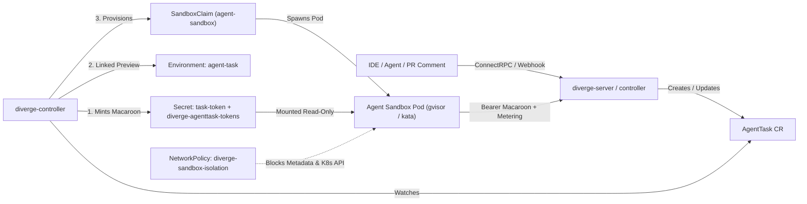

Diverge includes a Kubernetes-native execution engine for autonomous coding agents (`AgentTask`). Each task runs inside a network-isolated sandbox pod (`kubernetes-sigs/agent-sandbox`), authenticates with an attenuated **Macaroon capability token**, optionally provisions an automatic linked preview `Environment`, and enforces strict iteration, USD cost, token, and wall-clock timeout guardrails via live LLM metering (`POST /api/v1/agenttask/meter`).

---

## 1. Architecture Overview



### Key Security Properties

1. **Attenuated Macaroon Capability Tokens**:
   - Minted by `diverge-controller` using HMAC-SHA256 chained caveats (`task_id`, `namespace`, `repo`, `branch`, `tools`, `models`, `max_cost_usd`, `max_tokens`, `expires`).
   - Mounted read-only into the sandbox pod at `/etc/diverge/token/token`.
   - Verified by `diverge-server` against the namespace-scoped index Secret (`diverge-agenttask-tokens`) and live `AgentTask` phase (`Active`).
2. **Automatic Linked Preview Environments (`divergedev.com/preview-enabled: "true"`)**:
   - When `spec.repository.url` is set (and `divergedev.com/preview-enabled` is not `"false"`), `AgentTaskReconciler` automatically provisions and owns a linked `Environment` CR (`agent-preview-<task-name>`) tracking the agent's working branch, populates `divergedev.com/preview-environment` and `divergedev.com/preview-url` annotations, and injects `DIVERGE_PREVIEW_URL`, `DIVERGE_PREVIEW_HEADER_KEY`, and `DIVERGE_PREVIEW_HEADER_VALUE` into the sandbox pod.
3. **Idempotent Live LLM Cost & Token Metering (`POST /api/v1/agenttask/meter`)**:
   - Sandbox pods report token and USD cost deltas (with an idempotent `requestId` and `iteration`) to `POST /api/v1/agenttask/meter` on `diverge-server`.
   - Every metering heartbeat returns the latest `guidance`, `previewUrl`, `iteration`, and `maxIterations`.
   - If `tokensUsed`, `costUSD`, or `iteration` exceed the Macaroon caveats (`max_cost_usd`, `max_tokens`) or `AgentTask` spec (`budgetUSD`, `budgetTokens`, `maxIterations`), `diverge-server` atomically transitions the task to `Paused` (`Reason: BudgetExceeded`), marks the token `"revoked"` in `diverge-agenttask-tokens`, and returns `429 Too Many Requests` (`{"suspended": true}`).
4. **Sandbox Suspension, Linked Preview Hibernation & Token Rotation**:
   - Setting `spec.suspended: true` (via `diverge task pause` or `/diverge pause` on a PR/MR) transitions the task through `Pausing` to `Paused`, revokes the Macaroon token, suspends the sandbox (`spec.operatingMode: Suspended`), and hibernates the linked preview `Environment` (`divergedev.com/hibernated: "true"`).
   - Resuming a paused task (`diverge task resume --budget +15.00 --tokens 2000000` or `/diverge resume`) un-hibernates the linked preview, wakes the sandbox, and mints a fresh capability token projected automatically into `/etc/diverge/token/token`.
5. **Defense-in-Depth Network Isolation**:
   - The default `NetworkPolicy` (`<release>-sandbox-isolation`) denies all ingress to sandbox pods, restricts egress to DNS (53) and HTTPS/SSH (443/22), and blocks cloud metadata (`169.254.169.254/32`, `169.254.0.0/16`) and the in-cluster Kubernetes API (`10.96.0.1/32`).
   - Pod specs set `AutomountServiceAccountToken: false`, `ReadOnlyRootFilesystem: true`, `RunAsNonRoot: true`, and drop `ALL` Linux capabilities.

---

## 2. Enabling Agent Sandboxes in Helm

1. Create a 32-byte Macaroon root key Secret in the controller namespace:

```bash
kubectl create secret generic diverge-macaroon-root-key \
  -n diverge-system \
  --from-literal=root-key="$(openssl rand -hex 32)"
```

2. Install or upgrade the Diverge Helm chart with `sandbox.enabled=true` and `server.enabled=true`:

```bash
kubectl apply -f charts/diverge/crds/
helm upgrade --install diverge charts/diverge \
  --namespace diverge-system --create-namespace \
  --set server.enabled=true \
  --set sandbox.enabled=true \
  --set sandbox.provider=agent-sandbox \
  --set sandbox.macaroonSecretRef.name=diverge-macaroon-root-key \
  --set sandbox.networkPolicy.enabled=true
```

:::tip
For dry-run testing without creating sandbox pods or requiring the upstream `agents.x-k8s.io` CRDs, set `--set sandbox.provider=noop`. Starting in `v0.15.0` (`divergedev/diverge#308`), you can also set `--set sandbox.provider=pod` (or rely on automatic fallback from `agent-sandbox`) to provision hardened native Kubernetes `Pod`s (`sb-pod-<task>`) without the external `SandboxClaim` CRD controller.
:::

---

## 3. Repository Configuration (`.diverge/agent.yaml`) & Creating an `AgentTask`

### Scaffold `.diverge/agent.yaml` with `diverge task init`

Run `diverge task init` inside your repository to generate `.diverge/agent.yaml` with default model capabilities, allowed tools, budget caps, and sandbox settings:

```bash
diverge task init
```

```yaml
# .diverge/agent.yaml
version: "1"
agent:
  capabilities:
    - claude-3-7-sonnet
    - gemini-2.5-pro
  allowedTools:
    - git
    - go
    - npm
    - pytest
    - diverge_*
  budgetUSD: "5.00"
  maxIterations: 5
  baseBranch: main
  sandbox:
    provider: agent-sandbox
    timeoutSeconds: 3600
```

### Create & Manage Tasks from the CLI (`diverge task`)

```bash
# Submit an autonomous task from your terminal
diverge task create "Diagnose and fix N+1 query in /api/v1/checkout" --name fix-checkout-latency --budget 5.00 --base-branch main

# List tasks, inspect status, or stream live sandbox logs
diverge task list
diverge task status fix-checkout-latency
diverge task logs fix-checkout-latency -f

# Send real-time steering guidance (delivered on the next metering heartbeat)
diverge task guide fix-checkout-latency "Ensure backward compatibility with API v1 clients"

# Pause and resume with an additive budget bump (+$15.00 USD and +2,000,000 tokens)
diverge task pause fix-checkout-latency
diverge task resume fix-checkout-latency --budget +15.00 --tokens 2000000
```

### Declarative `AgentTask` Custom Resource

You can also apply an `AgentTask` Custom Resource directly with `kubectl`, via `diverge mcp`, or from a GitHub/GitLab PR comment (`/diverge fix <objective>`):

```yaml
apiVersion: divergedev.com/v1alpha1
kind: AgentTask
metadata:
  name: fix-checkout-latency
  namespace: default
  annotations:
    divergedev.com/preview-enabled: "true"
    divergedev.com/preview-service: "checkout-api"
    divergedev.com/preview-image: "ghcr.io/myorg/checkout-service:latest"
    divergedev.com/preview-port: "8080"
spec:
  objective: "Diagnose and fix N+1 query in /api/v1/checkout and verify in a preview environment"
  draftPR: true
  repository:
    url: https://github.com/myorg/checkout-service
    baseBranch: main
    workingBranch: fix/checkout-n-plus-1
  maxIterations: 8
  budgetUSD: "5.00"
  budgetTokens: 200000
  capabilities:
    - claude-3-7-sonnet
    - gemini-2.5-pro
  sandbox:
    provider: agent-sandbox
    timeoutSeconds: 1800
```

---

## 4. Live LLM Metering (`POST /api/v1/agenttask/meter`)

Inside the sandbox pod, the agent harness reports token usage, USD cost, `iteration`, and an idempotent `requestId` after each LLM invocation:

```bash
curl -X POST "$DIVERGE_METER_URL" \
  -H "Content-Type: application/json" \
  -H "Authorization: Bearer $(cat /etc/diverge/token/token)" \
  -d '{
    "requestId": "fix-checkout-iter-1",
    "iteration": 1,
    "model": "claude-3-7-sonnet",
    "tokensUsed": 1500,
    "costUSD": 0.0225
  }'
```

### Node.js & Python SDK Metering Helpers

Both `@divergedev/sdk` (Node.js) and `diverge-sdk` (Python) include built-in metering helpers that automatically read `DIVERGE_MACAROON_TOKEN` or `/etc/diverge/token/token` and surface live steering `guidance` and `previewUrl`:

```typescript
// Node.js (@divergedev/sdk)
import { meterLLMUsage, LLMMeterError } from '@divergedev/sdk';

try {
  const res = await meterLLMUsage({
    requestId: 'fix-checkout-iter-1',
    iteration: 1,
    model: 'claude-3-7-sonnet',
    tokensUsed: 1500,
    costUSD: 0.0225,
  });
  if (res.guidance) {
    console.log('Live steering guidance:', res.guidance);
  }
} catch (err) {
  if (err instanceof LLMMeterError && err.isBudgetExceeded) {
    process.exit(0); // Task auto-paused by diverge-server
  }
  throw err;
}
```

```python
# Python (diverge-sdk)
from diverge_sdk import meter_llm_usage, LLMMeterError

try:
    res = meter_llm_usage(
        model="claude-3-7-sonnet",
        tokens_used=1500,
        cost_usd=0.0225,
        request_id="fix-checkout-iter-1",
        iteration=1,
    )
    if res.guidance:
        print("Live steering guidance:", res.guidance)
except LLMMeterError as err:
    if err.is_budget_exceeded:
        raise SystemExit(0)
    raise
```

- **`200 OK`**: Returns `{"allowed": true, "suspended": false, "totalTokensUsed": 1500, "totalCostUSD": 0.0225, "iteration": 1, "maxIterations": 8, "guidance": "...", "previewUrl": "https://..."}`. Each distinct metered LLM call must use a unique `requestId` (even within the same iteration); retried calls whose `requestId` remains in the bounded 32-entry ring buffer (`status.lastMeterRequestIds`) are idempotent and do not double-charge.
- **`403 Forbidden`**: Returned when `allowed_models` (`spec.capabilities`) is configured on the token/task and `model` is omitted or not permitted (supporting exact or prefix wildcards like `claude-*`).
- **`429 Too Many Requests`**: Returned when cumulative usage exceeds the effective budget (`spec.budgetUSD` / `spec.budgetTokens` when positive, or the Macaroon's `max_cost_usd` / `max_tokens` caveats as fallback) with `"reason": "budget exceeded"`, or when `iteration > spec.maxIterations` with `"reason": "max iterations exceeded"`. The task is automatically suspended (`status.phase = Paused`, `spec.suspended = true`) and the Macaroon token is revoked in `diverge-agenttask-tokens`.

---

## 5. Steering & Pausing Tasks (`Paused` / `Active`)

### Pause Execution (`spec.suspended: true` or `/diverge pause`)

Once the controller reconciles `spec.suspended: true`, it transitions the `AgentTask` to `Paused` and revokes its Macaroon token so subsequent tool calls to `diverge-server` are rejected with `401 Unauthenticated`:

```bash
kubectl patch agenttask fix-checkout-latency --type=merge -p '{"spec":{"suspended":true}}'
```

### Guide & Resume Execution (`spec.suspended: false` or `/diverge resume`)

Use the `diverge_guide_task` / `diverge_resume_task` MCP tools, comment `/diverge resume` on the PR/MR, or patch `spec.suspended: false` with an updated budget:

```bash
kubectl patch agenttask fix-checkout-latency --type=merge -p '{
  "spec": {
    "suspended": false,
    "budgetUSD": "10.00",
    "maxIterations": 12
  }
}'
```

When resumed, `diverge-controller` mints a new Macaroon capability token reflecting the updated `budgetUSD` and `maxIterations` limits and clears the revocation marker in `diverge-agenttask-tokens`.

---

## 6. Linked Preview Annotations & Automatic PR / MR Status Comments (`SCMTaskNotifier`)

### Linked Preview Annotations
- **Input Annotations (on `AgentTask`)**:
  - `divergedev.com/preview-enabled`: `"true"` or `"false"`
  - `divergedev.com/preview-service`: Target Kubernetes service name (defaults to `<task.name>`)
  - `divergedev.com/preview-image`: Container image for the linked preview `Environment`
  - `divergedev.com/preview-port`: Container/service port exposed on the linked preview `Environment` (defaults to `80` or `8080`)
- **Output Annotations**:
  - `divergedev.com/preview-environment` and `divergedev.com/preview-url` on the `AgentTask`
  - `divergedev.com/sandbox-ip` on the linked `Environment` (propagating the live sandbox pod IP)

### Automatic PR / MR Status Comments (`SCMTaskNotifier`)
When `notifierProvider` (`github` or `gitlab`) is configured on `diverge-controller` (along with the corresponding SCM credentials via `DIVERGE_NOTIFIER_TOKEN`, `GITHUB_TOKEN`, `DIVERGE_GITLAB_TOKEN`, or `GITLAB_TOKEN`), `AgentTaskReconciler` automatically initializes an `SCMTaskNotifier` (`internal/notifier/task_notifier.go`) that posts and idempotently updates a sticky comment (`<!-- diverge-agent-task -->`) on the associated Pull Request or Merge Request whenever the `AgentTask` transitions across `Provisioning`, `Active`, `Paused`, `Completed`, or `Failed` phases. `/diverge fix` webhook handlers automatically attach `divergedev.com/provider`, `divergedev.com/project`, and `divergedev.com/pr-number` (or `divergedev.com/mr-iid`) annotations onto created `AgentTask` resources. The comment includes:
- Current phase badge (`🚀 Running` for `Provisioning` and `Active`, `⏸️ Paused`, `✅ Completed`, `❌ Failed`)
- Task objective and working branch
- One-click **Magic Link** (`?_diverge_env=`) to open the agent's linked preview environment and an **Exit Preview** (`?_diverge_env=clear`) link
- Live cumulative LLM token and USD spend (`status.tokensConsumed` / `status.costUSD`)

---

## 7. Bidirectional SCM Bot Interaction & PR/MR Slash Commands

Developers and reviewers can steer, pause, resume, and inspect `AgentTask` sandboxes directly from GitHub PR or GitLab MR comments:

| Slash Command | Action |
|---------------|--------|
| `/diverge fix <objective>` | Spawns or updates an `AgentTask` (`fix-pr-<num>` / `fix-mr-<iid>`) for the branch with the specified objective |
| `/diverge guide <hint>` | Sends live steering guidance (`divergedev.com/guidance`) delivered to the running agent on its next metering heartbeat |
| `/diverge budget [+$budget] [tokens]` | Bumps the task's USD and/or token budget without changing its suspension state |
| `/diverge pause` | Suspends the active `AgentTask` (`spec.suspended: true`), revokes its Macaroon token, and hibernates its linked preview environment |
| `/diverge resume [+$budget] [tokens]` | Resumes a paused `AgentTask` (`spec.suspended: false`) with optional additive budget bumps and mints a fresh Macaroon token |
| `/diverge status` | Posts an immediate Markdown summary of active `AgentTask`s and linked preview environments |
| `/diverge help` | Displays the interactive slash command reference table |

---

## 8. Reference Autonomous Agent Runner (`cmd/agent-runner`) & Admission Guardrails

Diverge ships a reference sandbox entrypoint binary (`cmd/agent-runner`, packaged via `Dockerfile.agent-runner` as `ghcr.io/divergedev/agent-runner`) that executes inside `PodSandboxProvider` and `AgentSandboxProvider` pods:

1. **Capability Token Resolution**: Checks `DIVERGE_MACAROON_TOKEN` first and reads the mounted token file at `DIVERGE_TOKEN_FILE` (`/etc/diverge/token/token`) only when `DIVERGE_MACAROON_TOKEN` is empty.
2. **Shallow Workspace Clone**: Clones `DIVERGE_REPO_URL` (`--depth=50 --branch $DIVERGE_BASE_BRANCH`) into `DIVERGE_WORKSPACE_DIR` (`/workspace`) and checks out `DIVERGE_WORKING_BRANCH` (`agent/<task-name>`).
3. **Metered Build-Verify-Fix Loop (`1..DIVERGE_MAX_ITERATIONS`)**:
   - Reports token and USD consumption to `POST $DIVERGE_METER_URL` before each iteration, halting immediately on `429 Too Many Requests` (`ErrBudgetExceeded`) or `403 Forbidden` (`ErrModelDisallowed`).
   - Runs `DIVERGE_AGENT_CMD` (receiving `DIVERGE_LAST_FAILURE` on retry iterations) and validates the fix using `DIVERGE_VERIFY_CMD` plus optional live HTTP health checks against `DIVERGE_PREVIEW_URL` with the `x-diverge-env` routing header.
   - Stages, commits (`fix(<task>): <objective>`), and pushes `DIVERGE_WORKING_BRANCH` once verification passes.

### Admission Webhooks & CEL `ValidatingAdmissionPolicy`

Enable admission-time validation for `Environment`, `PreviewGroup`, and `AgentTask` Custom Resources in the Helm chart:

```bash
helm upgrade --install diverge charts/diverge \
  --namespace diverge-system \
  --set certManager.enabled=true \
  --set webhook.validatingWebhook.enabled=true \
  --set webhook.admissionPolicy.enabled=true
```


