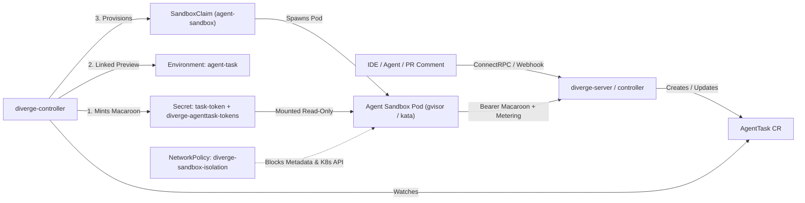

Diverge includes a Kubernetes-native execution engine for autonomous coding agents (`AgentTask`). Each task runs inside a network-isolated sandbox pod (`kubernetes-sigs/agent-sandbox`), authenticates with an attenuated **Macaroon capability token**, optionally provisions an automatic linked preview `Environment`, and enforces strict iteration, USD cost, token, and wall-clock timeout guardrails via live LLM metering (`POST /api/v1/agenttask/meter`).

---

## 1. Architecture Overview



### Key Security Properties

1. **Attenuated Macaroon Capability Tokens**:
   - Minted by `diverge-controller` using HMAC-SHA256 chained caveats (`task_id`, `namespace`, `repo`, `branch`, `tools`, `models`, `max_cost_usd`, `max_tokens`, `expires`).
   - Mounted read-only into the sandbox pod at `/etc/diverge/token/token`.
   - Verified by `diverge-server` against the namespace-scoped index Secret (`diverge-agenttask-tokens`) and live `AgentTask` phase (`Active`).
2. **Automatic Linked Preview Environments (`spec.createPreview: true`)**:
   - When `spec.createPreview: true` (or `spec.previewEnvironmentRef` is set), `AgentTaskReconciler` automatically provisions and owns a linked `Environment` CR (`agent-<task-name>`) tracking the agent's working branch, sets `status.previewEnvironmentName` and `status.previewURL`, and injects `DIVERGE_PREVIEW_ENV` and `DIVERGE_PREVIEW_URL` into the sandbox pod.
3. **Live LLM Cost & Token Metering (`POST /api/v1/agenttask/meter`)**:
   - Sandbox pods report token and USD cost deltas to `POST /api/v1/agenttask/meter` on `diverge-server`.
   - If `tokensUsed`, `estimatedCostUSD`, or `iterations` exceed the Macaroon caveats (`max_cost_usd`, `max_tokens`) or `AgentTask` spec (`budgetUSD`, `budgetTokens`, `maxIterations`), `diverge-server` atomically transitions the task to `Paused` (`Reason: BudgetExceeded`), marks the token `"revoked"` in `diverge-agenttask-tokens`, and returns `429 Too Many Requests` (`{"suspended": true}`).
4. **Revocation on Pause, Budget Exceeded, or Completion**:
   - Setting `spec.suspended: true` (or running `/diverge pause` on a PR/MR) transitions the task to `Paused` and marks the token revoked in `diverge-agenttask-tokens`.
   - Resuming a paused task (`/diverge resume` or setting `spec.suspended: false`) mints a fresh capability token with updated budget/expiry caveats.
5. **Defense-in-Depth Network Isolation**:
   - The default `NetworkPolicy` (`<release>-sandbox-isolation`) denies all ingress to sandbox pods, restricts egress to DNS (53) and HTTPS/SSH (443/22), and blocks cloud metadata (`169.254.169.254/32`, `169.254.0.0/16`) and the in-cluster Kubernetes API (`10.96.0.1/32`).
   - Pod specs set `AutomountServiceAccountToken: false`, `ReadOnlyRootFilesystem: true`, `RunAsNonRoot: true`, and drop `ALL` Linux capabilities.

---

## 2. Enabling Agent Sandboxes in Helm

1. Create a 32-byte Macaroon root key Secret in the controller namespace:

```bash
kubectl create secret generic diverge-macaroon-root-key \
  -n diverge-system \
  --from-literal=root-key="$(openssl rand -hex 32)"
```

2. Install or upgrade the Diverge Helm chart with `sandbox.enabled=true` and `server.enabled=true`:

```bash
kubectl apply -f charts/diverge/crds/
helm upgrade --install diverge charts/diverge \
  --namespace diverge-system --create-namespace \
  --set server.enabled=true \
  --set sandbox.enabled=true \
  --set sandbox.provider=agent-sandbox \
  --set sandbox.macaroonSecretRef.name=diverge-macaroon-root-key \
  --set sandbox.networkPolicy.enabled=true
```

:::tip
**Built-in Kubernetes `pod` Sandbox Provider & Automatic Fallback**:
On clusters without the external `extensions.agents.x-k8s.io` (`agent-sandbox`) CRD controller installed, you can set `--set sandbox.provider=pod` (or `spec.sandbox.provider: pod`) to provision hardened Kubernetes `Pod`s (`sb-pod-<task>`) with dropped capabilities, `runAsNonRoot: true`, `RuntimeDefault` seccomp, optional `divergedev.com/runtime-class` (`gvisor` / `kata`), `10Gi` workspace `emptyDir`, and mounted Macaroon tokens. Even when `provider: agent-sandbox` is selected, Diverge automatically falls back to the native `pod` provider if the `SandboxClaim` CRD is not registered on the cluster. For dry-run testing without creating pods, set `--set sandbox.provider=noop`.
:::

---

## 3. Creating an `AgentTask`

Apply an `AgentTask` Custom Resource directly with `kubectl`, via `diverge mcp`, or from a GitHub/GitLab PR comment (`/diverge fix <objective>`):

```yaml
apiVersion: divergedev.com/v1alpha1
kind: AgentTask
metadata:
  name: fix-checkout-latency
  namespace: default
  annotations:
    divergedev.com/preview-enabled: "true"
spec:
  objective: "Diagnose and fix N+1 query in /api/v1/checkout and verify in a preview environment"
  draftPR: true
  repository:
    url: https://github.com/myorg/checkout-service
    baseBranch: main
    workingBranch: fix/checkout-n-plus-1
  maxIterations: 8
  budgetUSD: "5.00"
  budgetTokens: 200000
  capabilities:
    - claude-3-7-sonnet
    - gemini-2.5-pro
  sandbox:
    provider: agent-sandbox
    timeoutSeconds: 1800
```

---

## 4. Live LLM Metering (`POST /api/v1/agenttask/meter`)

Inside the sandbox pod, the agent harness reports token usage and USD cost after each LLM invocation:

```bash
curl -X POST "$DIVERGE_SERVER_URL/api/v1/agenttask/meter" \
  -H "Content-Type: application/json" \
  -H "Authorization: Bearer $(cat /etc/diverge/token/token)" \
  -d '{
    "model": "claude-3-7-sonnet",
    "tokensUsed": 1500,
    "costUSD": 0.0225
  }'
```

### Node.js & Python SDK Metering Helpers

Both `@divergedev/sdk` (Node.js) and `diverge-sdk` (Python) include built-in metering helpers that automatically read `DIVERGE_MACAROON_TOKEN` or `/etc/diverge/token/token`:

```typescript
// Node.js (@divergedev/sdk)
import { meterLLMUsage, LLMMeterError } from '@divergedev/sdk';

try {
  const res = await meterLLMUsage({
    model: 'claude-3-7-sonnet',
    tokensUsed: 1500,
    costUSD: 0.0225,
  });
} catch (err) {
  if (err instanceof LLMMeterError && err.isBudgetExceeded) {
    process.exit(0); // Task auto-paused by diverge-server
  }
  throw err;
}
```

```python
# Python (diverge-sdk)
from diverge_sdk import meter_llm_usage, LLMMeterError

try:
    res = meter_llm_usage(
        model="claude-3-7-sonnet",
        tokens_used=1500,
        cost_usd=0.0225,
    )
except LLMMeterError as err:
    if err.is_budget_exceeded:
        raise SystemExit(0)
    raise
```

- **`200 OK`**: Returns `{"allowed": true, "suspended": false, "totalTokensUsed": 1500, "totalCostUSD": 0.0225}`.
- **`403 Forbidden`**: Returned if `model` is omitted or not listed in the Macaroon's `allowed_models` caveat (`spec.capabilities`).
- **`429 Too Many Requests`**: Returned when cumulative usage exceeds `max_cost_usd`, `max_tokens`, `budgetUSD`, or `budgetTokens`. The task is automatically suspended (`status.phase = Paused`, `spec.suspended = true`) and the Macaroon token is revoked in `diverge-agenttask-tokens`.

---

## 5. Steering & Pausing Tasks (`Paused` / `Active`)

### Pause Execution (`spec.suspended: true` or `/diverge pause`)

Once the controller reconciles `spec.suspended: true`, it transitions the `AgentTask` to `Paused` and revokes its Macaroon token so subsequent tool calls to `diverge-server` are rejected with `401 Unauthenticated`:

```bash
kubectl patch agenttask fix-checkout-latency --type=merge -p '{"spec":{"suspended":true}}'
```

### Guide & Resume Execution (`spec.suspended: false` or `/diverge resume`)

Use the `diverge_guide_task` / `diverge_resume_task` MCP tools, comment `/diverge resume` on the PR/MR, or patch `spec.suspended: false` with an updated budget:

```bash
kubectl patch agenttask fix-checkout-latency --type=merge -p '{
  "spec": {
    "suspended": false,
    "budgetUSD": "10.00",
    "maxIterations": 12
  }
}'
```

When resumed, `diverge-controller` mints a new Macaroon capability token reflecting the updated `budgetUSD` and `maxIterations` limits and clears the revocation marker in `diverge-agenttask-tokens`.
