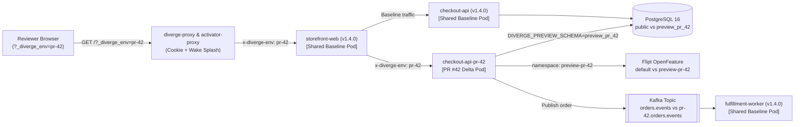

The [**Full-Stack Demo Monorepo (`examples/fullstack-demo/`)**](https://github.com/divergedev/diverge/tree/main/examples/fullstack-demo) in the Diverge repository is a complete, runnable 3-service reference architecture that demonstrates every major Diverge capability end-to-end on a local `kind` or `k3d` cluster.

:::tip[No cluster handy? Try it in your browser first]
Walk through all 6 stages of this exact demo architecture directly in your browser using the [**Interactive Architecture & Dashboard Tour**](/guides/interactive-tour/).
:::

---

## Architecture Overview

The demo models **Acme Shop**, a 3-service e-commerce checkout pipeline running in namespace `demo-staging`:

1. **`storefront-web` (`:8080`)**: Customer-facing web UI and Backend-for-Frontend (BFF). Reads incoming `x-diverge-env` (or `_diverge_env` cookie via `diverge-proxy`) and forwards `x-diverge-env` to `checkout-api`.
2. **`checkout-api` (`:8081`)**: Order & payout API service. Evaluates the `instant_payouts` OpenFeature flag from **Flipt**, writes orders into its isolated **PostgreSQL schema** (`public` in baseline, `preview_pr_42` in PR #42), and publishes order events to **Kafka**.
3. **`fulfillment-worker` (`:8082`)**: Async event consumer that processes settlement events from `orders.events` (or the isolated preview topic `pr-42.orders.events`).



---

## Quick Start (One-Command Local Walkthrough)

Run the automated walkthrough script against any local `kind` or `k3d` cluster (or pass `--dry-run` to preview every CLI and `kubectl` step without a cluster):

```bash
# Preview all 6 stages without a cluster:
./examples/fullstack-demo/scripts/run-demo.sh --dry-run

# Run end-to-end on a local kind cluster:
./examples/fullstack-demo/scripts/run-demo.sh
```

What `run-demo.sh` executes:
1. Validates `.diverge.yaml` against the embedded JSON Schema (`diverge validate`) and checks the topology graph for cycles (`diverge graph validate`).
2. Simulates how requests with `x-diverge-env` route from `storefront-web` to `checkout-api` (`diverge route checkout-api`).
3. Applies the shared baseline stack (`k8s/00-baseline.yaml`) and `PreviewGroup/pr-42` (`k8s/01-previewgroup-pr42.yaml`), which provisions PostgreSQL schema `preview_pr_42`, runs the Ariga Atlas migration job (`20260902000000_add_instant_payouts.sql`), syncs Flipt flag `instant_payouts = true`, and deploys `checkout-api-pr-42`.
4. Verifies baseline vs. preview routing using both `-H "x-diverge-env: pr-42"` and the browser cookie switcher URL `?_diverge_env=pr-42`.
5. Applies the scale-to-zero hibernation configuration (`k8s/02-environment-scale-to-zero.yaml` with `divergedev.com/hibernate-after: "15m"` and KEDA `minReplicas: 0`) and prints the routing commands (`run-demo.sh` applies the configuration and prints instructions; to manually verify wake-up and the `202 Accepted` splash screen, wait for hibernation and request `GET /-/wakeup-status` or send `-H "X-Diverge-Wake-Splash: true"`).
6. Applies `AgentTask/fix-pr-42-rounding` (`k8s/03-agenttask-fix-checkout.yaml`) in a `gvisor` sandbox with a `$5.00` / `200,000` token Macaroon budget and a linked `checkout-api` preview environment.

---

## Repository Layout (`examples/fullstack-demo/`)

```text
examples/fullstack-demo/
├── README.md
├── .diverge.yaml                        # Unified Diverge repository config
├── migrations/
│   ├── 20260901000000_init_orders.sql
│   ├── 20260902000000_add_instant_payouts.sql
│   └── atlas.sum
├── services/
│   ├── storefront-web/
│   │   └── main.go                      # BFF propagating x-diverge-env header
│   ├── checkout-api/
│   │   └── main.go                      # Reads PG schema + Flipt instant_payouts flag
│   └── fulfillment-worker/
│       └── main.go                      # Kafka consumer aware of x-diverge-env
├── k8s/
│   ├── 00-baseline.yaml                 # Shared staging Deployments & Services
│   ├── 01-previewgroup-pr42.yaml        # Delta PreviewGroup CR for PR #42
│   ├── 02-environment-scale-to-zero.yaml # Scale-to-zero & KEDA Environment CR
│   └── 03-agenttask-fix-checkout.yaml   # gVisor AgentTask CR with $5.00 Macaroon budget
└── scripts/
    └── run-demo.sh                      # Interactive / CI end-to-end runner (--dry-run | --live)
```

---

## Inside `.diverge.yaml`

The root [`.diverge.yaml`](https://github.com/divergedev/diverge/blob/main/examples/fullstack-demo/.diverge.yaml) configures delta detection paths, service dependency topology (`dependsOn`), header/cookie routing, database schema isolation with Atlas migrations, Flipt flags, and Kafka topic isolation:

```yaml
# yaml-language-server: $schema=https://divergedev.com/schemas/diverge.schema.json
version: "1"

services:
  storefront-web:
    entrypoint: true
    paths:
      - "services/storefront-web/**"
    image:
      repository: "ghcr.io/divergedev/demo-storefront-web"
      tag_template: "pr-{{.MR}}"
    dependsOn:
      - "checkout-api"

  checkout-api:
    paths:
      - "services/checkout-api/**"
      - "migrations/**"
    image:
      repository: "ghcr.io/divergedev/demo-checkout-api"
      tag_template: "pr-{{.MR}}"
    dependsOn:
      - "fulfillment-worker"
    asyncRoutes:
      - protocol: kafka
        target: orders-events
        envVarMapping:
          orders-events: ORDERS_QUEUE_TOPIC

  fulfillment-worker:
    paths:
      - "services/fulfillment-worker/**"
    image:
      repository: "ghcr.io/divergedev/demo-fulfillment-worker"
      tag_template: "pr-{{.MR}}"
    asyncRoutes:
      - protocol: kafka
        target: orders-events
        envVarMapping:
          orders-events: ORDERS_QUEUE_TOPIC

defaults:
  deploy:
    mode: delta
    namespace: same
  routing:
    mode: header
    baseline_namespace: default
    header_key: x-diverge-env
    domain: preview.localhost
    banner:
      enabled: true
      text: "Diverge Preview Environment"
      position: bottom
      color: "#FF5500"
  database:
    mode: schema
    connection_ref: postgres-admin
    atlas:
      mode: versioned
      engine: job
      migration_config_map: checkout-migrations
      policy:
        destructive: error
  features:
    provider: flipt
    overrides:
      instant_payouts: "true"
      checkout_v2_banner: "true"
  lifecycle:
    ttl: 24h
    cleanup_on_merge: true
  dev:
    on_conflict: warn

notifications:
  provider: github
  comment_on_create: true
  comment_on_ready: true
```

---

## Key Integration Patterns Shown in the Demo

### 1. Context Header Propagation (`storefront-web` → `checkout-api`)

Because `storefront-web` is **reused from baseline** when PR #42 only modifies `checkout-api`, `storefront-web` forwards the `x-diverge-env` header on outgoing HTTP calls so downstream traffic routes to `checkout-api-pr-42`:

```go
func forwardPreviewHeader(incoming *http.Request, outgoing *http.Request) {
	if env := incoming.Header.Get("x-diverge-env"); env != "" {
		outgoing.Header.Set("x-diverge-env", env)
	}
}
```

### 2. Automatic PostgreSQL Schema Isolation + Atlas Migrations

When `PreviewGroup/pr-42` reconciles, Diverge:
1. Creates schema `preview_pr_42` on the shared Postgres instance and writes connection details into `Secret/diverge-db-env-pr-42` (`DATABASE_URL` with `search_path=preview_pr_42,public` and `DIVERGE_PREVIEW_SCHEMA=preview_pr_42`).
2. Runs the Ariga Atlas migration Job against `preview_pr_42`, applying `20260902_add_instant_payouts.sql`:
   ```sql
   ALTER TABLE orders
     ADD COLUMN IF NOT EXISTS payout_rail TEXT NOT NULL DEFAULT 'RTP_INSTANT',
     ADD COLUMN IF NOT EXISTS instant_fee_bps INT NOT NULL DEFAULT 15;
   ```
3. Drops `preview_pr_42 CASCADE` automatically via the `divergedev.com/finalizer` when PR #42 is merged or closed.

### 3. Autonomous `AgentTask` Sandbox (`03-agenttask-fix-checkout.yaml`)

When a reviewer comments `/diverge fix "Fix currency rounding in instant payouts"` on PR #42, Diverge creates an `AgentTask` CR that runs in a `gvisor` sandbox with a linked preview environment (`divergedev.com/preview-enabled: "true"`) and a `$5.00` / `200,000` token Macaroon capability budget:

```yaml
apiVersion: divergedev.com/v1alpha1
kind: AgentTask
metadata:
  name: fix-pr-42-rounding
  namespace: default
  labels:
    app.kubernetes.io/part-of: diverge-fullstack-demo
  annotations:
    divergedev.com/preview-enabled: "true"
    divergedev.com/preview-service: "checkout-api"
    divergedev.com/runtime-class: "gvisor"
spec:
  objective: "Fix currency rounding discrepancy for instant payouts in checkout-api and add table-driven unit tests"
  repository:
    url: "https://github.com/divergedev/diverge.git"
    baseBranch: "main"
    workingBranch: "agent/fix-pr-42-rounding"
  sandbox:
    provider: "agent-sandbox"
    poolRef: "gvisor-warm-pool"
    templateRef: "gvisor"
    timeoutSeconds: 1800
  budgetUSD: "5.00"
  budgetTokens: 200000
  maxIterations: 5
  capabilities:
    - "claude-3-7-sonnet"
    - "fast"
    - "smart"
  draftPR: true
```

---

## Cleanup

To remove only the preview and agent task resources while keeping the shared baseline stack (`00-baseline.yaml`) running:

```bash
kubectl delete \
  -f examples/fullstack-demo/k8s/01-previewgroup-pr42.yaml \
  -f examples/fullstack-demo/k8s/02-environment-scale-to-zero.yaml \
  -f examples/fullstack-demo/k8s/03-agenttask-fix-checkout.yaml \
  --ignore-not-found
```

To tear down the entire demo (including the shared baseline Deployments and Services):

```bash
kubectl delete -f examples/fullstack-demo/k8s/ --ignore-not-found
```
