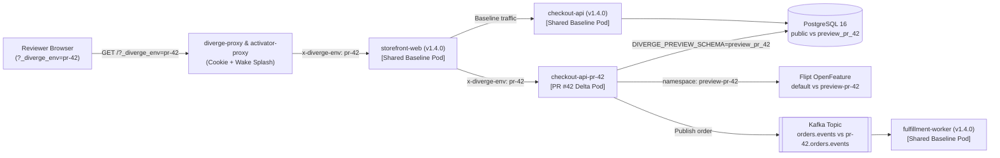

The [**Full-Stack Demo Monorepo (`examples/fullstack-demo/`)**](https://github.com/divergedev/diverge/tree/main/examples/fullstack-demo) in the Diverge repository is a complete, runnable 3-service reference architecture that demonstrates every major Diverge capability end-to-end on a local `kind` or `k3d` cluster.

:::tip[No cluster handy? Try it in your browser first]
Walk through all 6 stages of this exact demo architecture directly in your browser using the [**Interactive Architecture & Dashboard Tour**](/guides/interactive-tour/).
:::

---

## Architecture Overview

The demo models **Acme Shop**, a 3-service e-commerce checkout pipeline running in namespace `demo-staging`:

1. **`storefront-web` (`:8080`)**: Customer-facing web UI and Backend-for-Frontend (BFF). Reads incoming `x-diverge-env` (or `_diverge_env` cookie via `diverge-proxy`) and forwards `x-diverge-env` to `checkout-api`.
2. **`checkout-api` (`:8081`)**: Order & payout API service. Evaluates the `instant_payouts` OpenFeature flag from **Flipt**, writes orders into its isolated **PostgreSQL schema** (`public` in baseline, `preview_pr_42` in PR #42), and publishes order events to **Kafka**.
3. **`fulfillment-worker` (`:8082`)**: Async event consumer that processes settlement events from `orders.events` (or the isolated preview topic `pr-42.orders.events`).



---

## Quick Start (One-Command Local Walkthrough)

Run the automated walkthrough script against any local `kind` or `k3d` cluster (or pass `--dry-run` to preview every CLI and `kubectl` step without a cluster):

```bash
# Preview all 6 stages without a cluster:
./examples/fullstack-demo/scripts/run-demo.sh --dry-run

# Run end-to-end on a local kind cluster:
./examples/fullstack-demo/scripts/run-demo.sh
```

What `run-demo.sh` executes:
1. Bootstraps the shared baseline stack (`storefront-web`, `checkout-api`, `fulfillment-worker`, PostgreSQL, and Flipt) in `demo-staging`.
2. Runs `diverge diff` for **PR #42 (`feat/instant-payouts`)**, confirming that only `checkout-api` changed (`1 of 3` services deployed -> **67% compute saved**).
3. Applies `PreviewGroup/pr-42` (`examples/fullstack-demo/k8s/previewgroup-pr42.yaml`), which provisions PostgreSQL schema `preview_pr_42`, runs the Ariga Atlas migration job (`20260902_add_instant_payouts.sql`), syncs Flipt flag `instant_payouts = true`, and deploys `checkout-api-pr-42`.
4. Verifies baseline vs. preview routing using both `-H "x-diverge-env: pr-42"` and the browser cookie switcher URL `?_diverge_env=pr-42`.
5. Demonstrates scale-to-zero hibernation (`divergedev.com/hibernate-after: "30m"`) and the `202 Accepted` wake-up splash screen (`GET /-/wakeup-status`).
6. Applies `AgentTask/fix-pr-42-rounding` (`examples/fullstack-demo/k8s/agenttask-fix-pr42.yaml`), tests live Macaroon LLM budget metering (`POST /api/v1/agenttask/meter`), runs `diverge doctor`, and tears down PR #42 cleanly.

---

## Repository Layout (`examples/fullstack-demo/`)

```text
examples/fullstack-demo/
├── README.md
├── .diverge.yaml                        # Unified Diverge repository config
├── services/
│   ├── storefront-web/
│   │   └── main.go                      # BFF propagating x-diverge-env header
│   ├── checkout-api/
│   │   ├── main.go                      # Reads PG schema + Flipt instant_payouts flag
│   │   └── migrations/
│   │       ├── 20260901_init_orders.sql
│   │       └── 20260902_add_instant_payouts.sql
│   └── fulfillment-worker/
│       └── main.go                      # Kafka consumer aware of x-diverge-env
├── k8s/
│   ├── baseline.yaml                    # Shared staging Deployments & Services
│   ├── previewgroup-pr42.yaml           # Delta PreviewGroup CR for PR #42
│   └── agenttask-fix-pr42.yaml          # gVisor AgentTask CR with $5.00 Macaroon budget
└── scripts/
    └── run-demo.sh                      # Interactive / CI end-to-end runner
```

---

## Inside `.diverge.yaml`

The root [`.diverge.yaml`](https://github.com/divergedev/diverge/blob/main/examples/fullstack-demo/.diverge.yaml) configures delta detection paths, header/cookie routing, database schema isolation with Atlas migrations, Flipt flags, Kafka topic isolation, and scale-to-zero hibernation:

```yaml
version: "1"

services:
  storefront-web:
    paths:
      - "services/storefront-web/**"
    port: 8080
    image:
      repository: ghcr.io/divergedev/demo-storefront-web
      tag_template: "pr-{{.MR}}"

  checkout-api:
    paths:
      - "services/checkout-api/**"
    port: 8081
    image:
      repository: ghcr.io/divergedev/demo-checkout-api
      tag_template: "pr-{{.MR}}"

  fulfillment-worker:
    paths:
      - "services/fulfillment-worker/**"
    port: 8082
    image:
      repository: ghcr.io/divergedev/demo-fulfillment-worker
      tag_template: "pr-{{.MR}}"

defaults:
  deploy:
    mode: delta
  routing:
    mode: header
    header_name: x-diverge-env
    baseline_namespace: demo-staging
    cookie_switcher:
      enabled: true
      query_param: _diverge_env
    banner:
      enabled: true
  database:
    mode: schema
    atlas:
      mode: versioned
      engine: job
      migration_dir: services/checkout-api/migrations
  feature_flags:
    provider: flipt
    namespace_template: "preview-{{.Env}}"
  async:
    provider: kafka
    topics:
      - orders.events
  scale_to_zero:
    enabled: true
    hibernate_after: 30m
    wake_splash: true
  lifecycle:
    ttl: 48h
    cleanup_on_merge: true
```

---

## Key Integration Patterns Shown in the Demo

### 1. Context Header Propagation (`storefront-web` → `checkout-api`)

Because `storefront-web` is **reused from baseline** when PR #42 only modifies `checkout-api`, `storefront-web` forwards the `x-diverge-env` header on outgoing HTTP calls so downstream traffic routes to `checkout-api-pr-42`:

```go
func forwardPreviewHeader(incoming *http.Request, outgoing *http.Request) {
	if env := incoming.Header.Get("x-diverge-env"); env != "" {
		outgoing.Header.Set("x-diverge-env", env)
	}
}
```

### 2. Automatic PostgreSQL Schema Isolation + Atlas Migrations

When `PreviewGroup/pr-42` reconciles, Diverge:
1. Creates schema `preview_pr_42` on the shared Postgres instance and writes connection details into `Secret/diverge-db-env-pr-42` (`DATABASE_URL` with `search_path=preview_pr_42,public` and `DIVERGE_PREVIEW_SCHEMA=preview_pr_42`).
2. Runs the Ariga Atlas migration Job against `preview_pr_42`, applying `20260902_add_instant_payouts.sql`:
   ```sql
   ALTER TABLE orders
     ADD COLUMN IF NOT EXISTS payout_rail TEXT NOT NULL DEFAULT 'RTP_INSTANT',
     ADD COLUMN IF NOT EXISTS instant_fee_bps INT NOT NULL DEFAULT 15;
   ```
3. Drops `preview_pr_42 CASCADE` automatically via the `divergedev.com/finalizer` when PR #42 is merged or closed.

### 3. Autonomous `AgentTask` Sandbox (`agenttask-fix-pr42.yaml`)

When a reviewer comments `/diverge fix "Fix currency rounding in instant payouts"` on PR #42, Diverge creates an `AgentTask` CR that runs in a `gvisor` sandbox with a linked preview environment and a `$5.00` Macaroon capability token:

```yaml
apiVersion: divergedev.com/v1alpha1
kind: AgentTask
metadata:
  name: fix-pr-42-rounding
  namespace: demo-staging
spec:
  prompt: "Fix currency rounding in instant payouts fee calculation and add unit tests"
  repoURL: "https://github.com/divergedev/diverge.git"
  branch: "feat/instant-payouts"
  pullRequestNumber: 42
  sandboxClassName: gvisor
  createLinkedPreview: true
  budgetUSD: "5.00"
  budgetTokens: 200000
  maxIterations: 15
  allowedModels:
    - "claude-3-7-sonnet"
```

---

## Cleanup

To remove the `demo-staging` namespace and all preview resources created by the demo script:

```bash
./examples/fullstack-demo/scripts/run-demo.sh --cleanup
```
