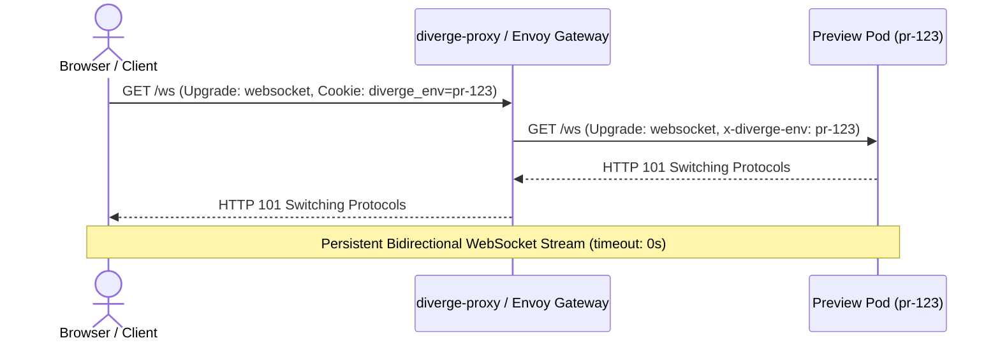

Real-time applications often rely on persistent WebSocket connections (`ws://` and `wss://`) for live notifications, chat, streaming data, and collaborative tools. Diverge natively supports WebSocket routing across both **header-based** (`x-diverge-env` / `diverge_env` cookie) and **subdomain** preview environments.

---

## 1. Configuring WebSocket Routes (`spec.serviceConfig.websocket`)

To prevent Gateway API proxies from prematurely closing long-lived WebSocket streams, enable `spec.serviceConfig.websocket` on your `Environment` Custom Resource:

```yaml
apiVersion: divergedev.com/v1alpha1
kind: Environment
metadata:
  name: chat-pr-123
spec:
  serviceConfig:
    serviceName: chat-service
    image: ghcr.io/acme/chat-service:pr-123
    port: 8080
    websocket:
      enabled: true
      # Optional: restrict WebSocket timeout rules to a specific path prefix
      path: /ws
      # Optional: Gateway API request timeout ("0s" disables the timeout for long-lived streams)
      timeout: 0s
```

### Fields

| Field | Default | Description |
| :--- | :--- | :--- |
| `enabled` | `false` | Enables dedicated Gateway API `HTTPRoute` timeout rules for WebSocket streams |
| `path` | `""` | Optional path prefix (e.g. `/ws`). When set, generates a dedicated high-priority `HTTPRoute` rule for that path |
| `timeout` | `"0s"` | Gateway API `timeouts.request` duration (`"0s"` disables request timeout for persistent connections) |

---

## 2. How It Works

When `websocket.enabled: true` is set:
1. **Gateway API `HTTPRoute` Rules**: `GatewayRouter` generates an `HTTPRoute` rule matching your preview header (`x-diverge-env: pr-123`) or preview subdomain (`pr-123.preview.example.com`) with `timeouts: { request: 0s }` (or your configured `timeout`).
2. **Browser Cookie & Magic Link Support (`?_diverge_env=`)**: Because browser `new WebSocket(url)` constructors cannot set custom HTTP headers directly, opening your preview via a Magic Link (`?_diverge_env=pr-123`) sets the `diverge_env=pr-123` session cookie, which `diverge-proxy` translates into `x-diverge-env: pr-123` on the initial HTTP `Upgrade: websocket` handshake.
3. **Baseline Fallback**: If a preview environment does not modify the WebSocket service, connections route transparently to the shared baseline deployment.


