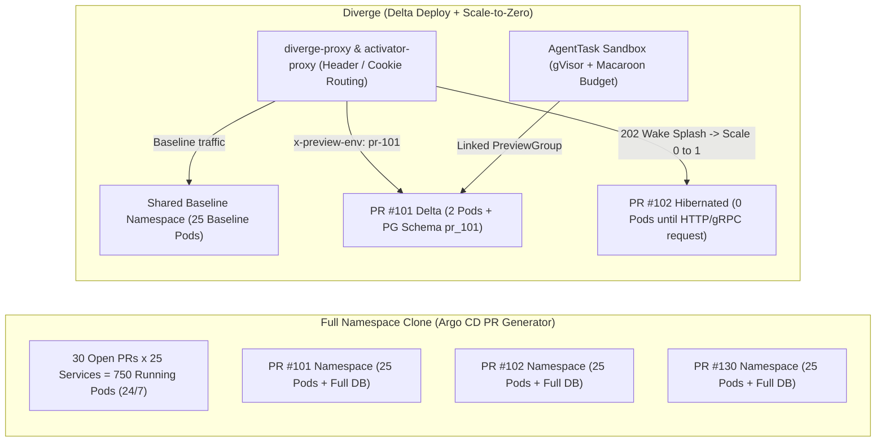

Platform teams building ephemeral preview environments on Kubernetes inevitably hit a wall: how do you give every pull request and AI coding agent a realistic, isolated test environment without multiplying your cloud bill by the number of open PRs or shipping cluster metadata to a third-party SaaS?

Diverge was built from the ground up to solve this problem inside your own Kubernetes cluster.

---

## The Ephemeral Environment Trilemma

Engineering organizations typically evaluate three approaches to Kubernetes preview environments—each with a fundamental architectural flaw:

<div class="comparison-showcase">
  <div class="comparison-box traditional">
    <span class="comparison-badge">The Legacy Trade-offs</span>
    <div class="comparison-title">Why Existing Approaches Break at Scale</div>
    <ul class="comparison-list">
      <li><strong>1. Full Namespace Clones (Argo CD PR Generator):</strong> Clones 100% of your microservices (<code>N services &times; M open PRs</code>) for every pull request—even for a 2-line change in one service. Leads to astronomical cloud bills, cluster IP/etcd exhaustion, and <strong>15+ minute cold spin-up times</strong>.</li>
      <li><strong>2. Local Intercepts (Telepresence / mirrord):</strong> Tunnels traffic from a shared cluster to a developer's laptop. Great for interactive debugging, but <strong>dies the moment the laptop closes</strong>, cannot run unattended in CI pipelines, cannot share a persistent preview URL with PMs/designers, and cannot isolate autonomous AI agents.</li>
      <li><strong>3. SaaS Control Planes (Signadot / Okteto):</strong> Requires connecting your production/staging clusters to an external vendor control plane, introduces per-seat or per-sandbox commercial lock-in, and lacks native unification of database branching, OpenFeature flag isolation, and Macaroon-governed AI agent sandboxes.</li>
    </ul>
  </div>
  <div class="comparison-box diverge">
    <span class="comparison-badge">The Diverge Architecture</span>
    <div class="comparison-title">Delta Deploy + Scale-to-Zero + Self-Hosted</div>
    <ul class="comparison-list">
      <li><strong>Delta Deployments Only:</strong> Deploys only the 1–2 services modified in a PR (<code>PreviewGroup</code>) and routes all other upstream/downstream calls through your shared baseline via L7 HTTP/gRPC headers or Kafka/Temporal isolation.</li>
      <li><strong>Scale-to-Zero &amp; Idle Hibernation:</strong> Idle PRs scale down to <code>0</code> pods via <code>activator-proxy</code>, KEDA HTTP Add-on, Knative, or zero-dependency <code>divergedev.com/hibernate-after</code> annotations—waking in seconds with a browser-friendly splash screen.</li>
      <li><strong>Full-Stack &amp; AI-Native Isolation:</strong> Combines isolated PostgreSQL schemas/branches + Atlas migrations, OpenFeature <code>flagd</code>/<code>Flipt</code> flags, and gVisor/Kata <code>AgentTask</code> sandboxes under a 100% self-hosted Apache 2.0 operator.</li>
    </ul>
  </div>
</div>

### Architectural Footprint: Full Clone vs. Diverge Delta + Scale-to-Zero



---

## Head-to-Head Comparison Matrix

| Capability | **Diverge** | **Argo CD PR Generator (Full Clone)** | **Telepresence** | **Signadot** | **Okteto** |
| :--- | :--- | :--- | :--- | :--- | :--- |
| **1. Deployment Footprint** | **Delta Deploy** of changed services only (`PreviewGroup` + shared baseline fallback); also supports full-clone mode | Clones **100% of services** (`N × M` pods) per PR namespace | Local workstation process intercepting 1 service; no cluster-hosted PR lifecycle | Route-based sandboxes (`Sandbox` CRD) sharing baseline | Full namespace clone per developer/PR by default (or hybrid divert) |
| **2. Idle Resource Cost** | **Scale-to-Zero** via `activator-proxy` (`--wake-splash`), KEDA `HTTPScaledObject`, Knative, or native `divergedev.com/hibernate-after` idle hibernation | **24/7 running pods** for every open PR until PR merge/close | Runs on developer laptop CPU/RAM (dies when laptop sleeps) | Always-on sandbox pods while PR is open (TTL teardown, no built-in wake-splash activator) | Automated sleep/wake on commercial tiers; heavy full-stack footprint when awake |
| **3. Database Isolation** | **6-mode Database Provider** (`schema` per PR with auto-provisioned `DATABASE_URL` & `DIVERGE_PREVIEW_SCHEMA`, `neon`, `cnpg`, `cockroach`, `snapshot`, `shared`) + native **Ariga Atlas** migrations | Heavy full DB container per PR (slow, unseeded) or manual custom scripting | Manual local DB or shared staging DB (high risk of developer schema collisions) | Custom resource plugins (DIY scripts for schema/branch provisioning) | Volume snapshots or full DB container clones per namespace |
| **4. Async Message Queue Isolation** | **Native Kafka & Temporal** (`AsyncProvisioner` for isolated topics, consumer groups, and Temporal task queues) + Webhook provider | Requires duplicating Kafka/Temporal clusters per PR or manual topic prefixing | Primarily HTTP/gRPC L7 intercept; queues require manual consumer filtering | Requires application-level SDK header inspection & custom consumer routing | Full broker clone per namespace or manual topic isolation |
| **5. Feature Flag Isolation** | **Native OpenFeature** integration (`flagd` per-PR `ConfigMap` overrides & ephemeral **Flipt** namespaces auto-cleaned on PR merge) | Manual `ConfigMap` duplication or shared global feature flags | None built-in (shares cluster or local env flags) | None built-in (requires external flag provider routing rules) | None built-in |
| **6. Autonomous AI Agent Sandboxes** | **First-class `AgentTask` CRDs** with **gVisor / Kata** isolation, attenuated **Macaroon capability tokens**, linked previews, MCP server, & live `/api/v1/agenttask/meter` budget enforcement | None | None | None (focused on human/CI service sandboxes) | None (general dev containers without K8s-native Macaroon or LLM budget governance) |
| **7. Shareable Browser Previews** | **One-click `?_diverge_env=pr-42` URL cookie switcher** + optional floating preview switcher banner + auto-refreshing wake-up splash page — **no browser extension required** | Dedicated DNS hostname per PR (requires wildcard DNS + TLS per PR) | Requires commercial cloud login / browser extension and developer laptop online | Browser extension or SaaS proxy URLs | Subdomain URLs managed by Okteto proxy |
| **8. Control Plane & Licensing** | **100% self-hosted Kubernetes operator** + embedded React Web Dashboard & ConnectRPC API. **Apache 2.0 Open Source** | Self-hosted Kubernetes operator (Apache 2.0), but requires custom glue for DBs, routing, & cleanup | OSS client/traffic-manager + commercial control plane for team features | **Proprietary SaaS** control plane with in-cluster agent (commercial) | **Proprietary SaaS / Enterprise** self-hosted license |

---

## Interactive Preview Cost & Savings Calculator

How much cloud compute does **Delta Deployment + Scale-to-Zero** save compared to cloning a full namespace per PR?

Use the interactive calculator below. It uses the exact default rate card built into Diverge's Prometheus cost estimator (`diverge_environment_estimated_hourly_cost_usd`): **`$0.031611` per vCPU-hour** and **`$0.004237` per GiB-hour**, assuming a typical microservice replica footprint of **`0.5 vCPU` + `1 GiB RAM`** (`$0.0200425 / pod-hour` or `$14.63 / pod-month` across a `730`-hour month).

<div class="diverge-calc-card" id="diverge-cost-calculator">
  <div class="diverge-calc-header">
    <div>
      <span class="diverge-calc-badge">Live Cost Estimator</span>
      <h3 class="diverge-calc-title">Preview Environment Cloud Cost &amp; Savings</h3>
    </div>
    <div class="diverge-calc-rate-pill">
      Rate Card: <code>0.5 vCPU + 1 GiB</code> = <code>$0.02004/pod-hr</code>
    </div>
  </div>

  <div class="diverge-calc-grid">
    <div class="diverge-calc-controls">
      <div class="diverge-slider-group">
        <div class="diverge-slider-label">
          <label for="calc-services">Total Microservices in Baseline Stack</label>
          <output id="out-services" for="calc-services">25 services</output>
        </div>
        <input type="range" id="calc-services" min="5" max="100" step="1" value="25" />
        <div class="diverge-slider-ticks"><span>5</span><span>50</span><span>100</span></div>
      </div>

      <div class="diverge-slider-group">
        <div class="diverge-slider-label">
          <label for="calc-prs">Average Concurrent Open PRs</label>
          <output id="out-prs" for="calc-prs">30 PRs</output>
        </div>
        <input type="range" id="calc-prs" min="5" max="200" step="1" value="30" />
        <div class="diverge-slider-ticks"><span>5</span><span>100</span><span>200</span></div>
      </div>

      <div class="diverge-slider-group">
        <div class="diverge-slider-label">
          <label for="calc-modified">Average Services Modified per PR (Delta)</label>
          <output id="out-modified" for="calc-modified">2 services</output>
        </div>
        <input type="range" id="calc-modified" min="1" max="10" step="1" value="2" />
        <div class="diverge-slider-ticks"><span>1</span><span>5</span><span>10</span></div>
      </div>

      <div class="diverge-slider-group">
        <div class="diverge-slider-label">
          <label for="calc-hours">Active Testing Hours per PR / Day (Scale-to-Zero)</label>
          <output id="out-hours" for="calc-hours">4 hrs / day</output>
        </div>
        <input type="range" id="calc-hours" min="1" max="24" step="1" value="4" />
        <div class="diverge-slider-ticks"><span>1h (96% idle)</span><span>12h</span><span>24h (always-on)</span></div>
      </div>
    </div>

    <div class="diverge-calc-results">
      <div class="diverge-result-row diverge-result-clone">
        <div class="diverge-result-meta">
          <span class="diverge-result-name">Full Namespace Clone (Argo CD PR Gen)</span>
          <span class="diverge-result-sub" id="res-clone-pods">750 always-on preview pods</span>
        </div>
        <div class="diverge-result-price" id="res-clone-cost">$10,973<span>/mo</span></div>
      </div>

      <div class="diverge-result-row diverge-result-delta">
        <div class="diverge-result-meta">
          <span class="diverge-result-name">Diverge Delta Deploy (Always-On)</span>
          <span class="diverge-result-sub" id="res-delta-pods">60 delta pods (shared baseline)</span>
        </div>
        <div class="diverge-result-price" id="res-delta-cost">$878<span>/mo</span></div>
      </div>

      <div class="diverge-result-row diverge-result-s2z">
        <div class="diverge-result-meta">
          <span class="diverge-result-name">Diverge Delta + Scale-to-Zero</span>
          <span class="diverge-result-sub" id="res-s2z-pods">10.0 active pod-equivalents (hibernated 20h/day)</span>
        </div>
        <div class="diverge-result-price diverge-price-accent" id="res-s2z-cost">$146<span>/mo</span></div>
      </div>

      <div class="diverge-savings-banner">
        <div class="diverge-savings-main">
          <div>
            <div class="diverge-savings-label">Net Monthly Cloud Savings</div>
            <div class="diverge-savings-value" id="res-monthly-savings">$10,827/mo</div>
          </div>
          <div class="diverge-savings-pct" id="res-savings-pct">98.7% Saved</div>
        </div>
        <div class="diverge-savings-annual">
          Projected Annual Compute Savings: <strong id="res-annual-savings">$129,924 / year</strong>
        </div>
      </div>
    </div>
  </div>
</div>

<style>
  .diverge-calc-card {
    background: var(--sl-color-bg-nav, rgba(18, 20, 27, 0.85));
    border: 1px solid var(--sl-color-hairline, rgba(255, 255, 255, 0.1));
    border-radius: 16px;
    padding: 1.75rem;
    margin: 2rem 0 2.5rem 0;
    box-shadow:
      inset 0 1px 0 0 rgba(255, 255, 255, 0.06),
      0 12px 32px -4px rgba(0, 0, 0, 0.45);
    color: var(--sl-color-text, #e2e8f0);
  }

  .diverge-calc-header {
    display: flex;
    justify-content: space-between;
    align-items: flex-start;
    gap: 1rem;
    flex-wrap: wrap;
    border-bottom: 1px solid var(--sl-color-hairline, rgba(255, 255, 255, 0.08));
    padding-bottom: 1.1rem;
    margin-bottom: 1.5rem;
  }

  .diverge-calc-badge {
    display: inline-block;
    font-size: 0.72rem;
    font-weight: 700;
    text-transform: uppercase;
    letter-spacing: 0.06em;
    padding: 0.2rem 0.6rem;
    border-radius: 9999px;
    background: rgba(255, 85, 0, 0.14);
    color: var(--sl-color-accent-high, #ffa366);
    border: 1px solid rgba(255, 85, 0, 0.3);
    margin-bottom: 0.4rem;
  }

  .diverge-calc-title {
    margin: 0 !important;
    font-size: 1.35rem !important;
    font-weight: 700 !important;
    color: var(--sl-color-white, #ffffff) !important;
  }

  .diverge-calc-rate-pill {
    font-size: 0.82rem;
    padding: 0.35rem 0.75rem;
    border-radius: 8px;
    background: rgba(255, 255, 255, 0.03);
    border: 1px solid var(--sl-color-hairline, rgba(255, 255, 255, 0.08));
    color: var(--sl-color-gray-3, #94a3b8);
  }

  .diverge-calc-grid {
    display: grid;
    grid-template-columns: 1.05fr 1fr;
    gap: 1.75rem;
    align-items: stretch;
  }

  @media (max-width: 860px) {
    .diverge-calc-grid {
      grid-template-columns: 1fr;
    }
  }

  .diverge-calc-controls {
    display: flex;
    flex-direction: column;
    gap: 1.15rem;
  }

  .diverge-slider-group {
    background: rgba(255, 255, 255, 0.02);
    border: 1px solid var(--sl-color-hairline, rgba(255, 255, 255, 0.07));
    border-radius: 10px;
    padding: 0.85rem 1rem;
  }

  .diverge-slider-label {
    display: flex;
    justify-content: space-between;
    align-items: baseline;
    gap: 0.5rem;
    margin-bottom: 0.45rem;
    font-size: 0.88rem;
    font-weight: 500;
    color: var(--sl-color-text, #e2e8f0);
  }

  .diverge-slider-label output {
    font-family: var(--sl-font-mono, monospace);
    font-weight: 700;
    font-size: 0.92rem;
    color: var(--sl-color-accent-high, #ffa366);
    font-variant-numeric: tabular-nums;
    white-space: nowrap;
  }

  .diverge-slider-group input[type='range'] {
    width: 100%;
    accent-color: var(--sl-color-accent, #ff5500);
    cursor: pointer;
    margin: 0.25rem 0;
  }

  .diverge-slider-ticks {
    display: flex;
    justify-content: space-between;
    font-size: 0.72rem;
    color: var(--sl-color-gray-4, #64748b);
    margin-top: 0.15rem;
  }

  .diverge-calc-results {
    display: flex;
    flex-direction: column;
    justify-content: space-between;
    gap: 0.85rem;
  }

  .diverge-result-row {
    display: flex;
    justify-content: space-between;
    align-items: center;
    gap: 1rem;
    padding: 0.9rem 1.1rem;
    border-radius: 10px;
    border: 1px solid var(--sl-color-hairline, rgba(255, 255, 255, 0.08));
    background: rgba(255, 255, 255, 0.02);
  }

  .diverge-result-clone {
    background: rgba(239, 68, 68, 0.06);
    border-color: rgba(239, 68, 68, 0.22);
  }

  .diverge-result-s2z {
    background: rgba(255, 85, 0, 0.09);
    border-color: rgba(255, 85, 0, 0.38);
  }

  .diverge-result-meta {
    display: flex;
    flex-direction: column;
    gap: 0.15rem;
  }

  .diverge-result-name {
    font-weight: 600;
    font-size: 0.92rem;
    color: var(--sl-color-white, #ffffff);
  }

  .diverge-result-sub {
    font-size: 0.78rem;
    color: var(--sl-color-gray-3, #94a3b8);
    font-variant-numeric: tabular-nums;
  }

  .diverge-result-price {
    font-family: var(--sl-font-mono, monospace);
    font-size: 1.35rem;
    font-weight: 700;
    color: var(--sl-color-white, #ffffff);
    font-variant-numeric: tabular-nums;
    white-space: nowrap;
  }

  .diverge-result-price span {
    font-size: 0.8rem;
    font-weight: 400;
    color: var(--sl-color-gray-3, #94a3b8);
    margin-left: 0.15rem;
  }

  .diverge-price-accent {
    color: var(--sl-color-accent-high, #ffa366);
  }

  .diverge-savings-banner {
    border-radius: 12px;
    padding: 1.1rem 1.25rem;
    background: linear-gradient(135deg, rgba(255, 85, 0, 0.18) 0%, rgba(255, 122, 41, 0.06) 100%);
    border: 1px solid var(--sl-color-accent, #ff5500);
    margin-top: 0.2rem;
  }

  .diverge-savings-main {
    display: flex;
    justify-content: space-between;
    align-items: center;
    gap: 1rem;
    flex-wrap: wrap;
  }

  .diverge-savings-label {
    font-size: 0.78rem;
    text-transform: uppercase;
    letter-spacing: 0.05em;
    font-weight: 700;
    color: var(--sl-color-accent-high, #ffa366);
  }

  .diverge-savings-value {
    font-family: var(--sl-font-mono, monospace);
    font-size: 1.85rem;
    font-weight: 800;
    color: var(--sl-color-white, #ffffff);
    font-variant-numeric: tabular-nums;
    line-height: 1.15;
  }

  .diverge-savings-pct {
    background: var(--sl-color-accent, #ff5500);
    color: #ffffff;
    font-family: var(--sl-font-mono, monospace);
    font-weight: 700;
    font-size: 0.9rem;
    padding: 0.35rem 0.75rem;
    border-radius: 9999px;
    font-variant-numeric: tabular-nums;
  }

  .diverge-savings-annual {
    margin-top: 0.65rem;
    padding-top: 0.65rem;
    border-top: 1px solid rgba(255, 255, 255, 0.1);
    font-size: 0.86rem;
    color: var(--sl-color-text, #cbd5e1);
    font-variant-numeric: tabular-nums;
  }
</style>

<script>
  (function () {
    const CPU_HOURLY_RATE = 0.031611; // $/vCPU-hr
    const MEM_HOURLY_RATE = 0.004237; // $/GiB-hr
    const POD_HOURLY_RATE = 0.5 * CPU_HOURLY_RATE + 1.0 * MEM_HOURLY_RATE; // $0.0200425/hr
    const HOURS_PER_MONTH = 730;

    const elServices = document.getElementById('calc-services');
    const elPRs = document.getElementById('calc-prs');
    const elModified = document.getElementById('calc-modified');
    const elHours = document.getElementById('calc-hours');

    if (!elServices || !elPRs || !elModified || !elHours) return;

    const fmtUSD = new Intl.NumberFormat('en-US', {
      style: 'currency',
      currency: 'USD',
      maximumFractionDigits: 0,
    });

    function updateCalculator() {
      const services = parseInt(elServices.value, 10) || 25;
      const openPRs = parseInt(elPRs.value, 10) || 30;
      const rawModified = parseInt(elModified.value, 10) || 2;
      const modifiedServices = Math.min(rawModified, services);
      const activeHours = parseInt(elHours.value, 10) || 4;

      document.getElementById('out-services').textContent =
        services + (services === 1 ? ' service' : ' services');
      document.getElementById('out-prs').textContent = openPRs + ' PRs';
      document.getElementById('out-modified').textContent =
        modifiedServices + (modifiedServices === 1 ? ' service' : ' services');
      document.getElementById('out-hours').textContent = activeHours + ' hrs / day';

      const clonePods = services * openPRs;
      const deltaPods = modifiedServices * openPRs;
      const activePodEq = deltaPods * (activeHours / 24);
      const idleHours = 24 - activeHours;

      const cloneMonthly = clonePods * HOURS_PER_MONTH * POD_HOURLY_RATE;
      const deltaMonthly = deltaPods * HOURS_PER_MONTH * POD_HOURLY_RATE;
      const s2zMonthly = activePodEq * HOURS_PER_MONTH * POD_HOURLY_RATE;

      const monthlySavings = Math.max(0, cloneMonthly - s2zMonthly);
      const annualSavings = monthlySavings * 12;
      const savingsPct = cloneMonthly > 0 ? (monthlySavings / cloneMonthly) * 100 : 0;

      document.getElementById('res-clone-pods').textContent =
        clonePods.toLocaleString('en-US') + ' always-on preview pods';
      document.getElementById('res-delta-pods').textContent =
        deltaPods.toLocaleString('en-US') + ' delta pods (shared baseline)';
      document.getElementById('res-s2z-pods').textContent =
        activePodEq.toFixed(1) +
        ' active pod-equivalents (hibernated ' +
        idleHours +
        'h/day)';

      document.getElementById('res-clone-cost').innerHTML =
        fmtUSD.format(cloneMonthly) + '<span>/mo</span>';
      document.getElementById('res-delta-cost').innerHTML =
        fmtUSD.format(deltaMonthly) + '<span>/mo</span>';
      document.getElementById('res-s2z-cost').innerHTML =
        fmtUSD.format(s2zMonthly) + '<span>/mo</span>';

      document.getElementById('res-monthly-savings').textContent =
        fmtUSD.format(monthlySavings) + '/mo';
      document.getElementById('res-annual-savings').textContent =
        fmtUSD.format(annualSavings) + ' / year';
      document.getElementById('res-savings-pct').textContent =
        savingsPct.toFixed(1) + '% Saved';
    }

    [elServices, elPRs, elModified, elHours].forEach(function (input) {
      input.addEventListener('input', updateCalculator);
    });

    updateCalculator();
  })();
</script>

### How the Cost Formulas Work

Diverge's controller exposes a built-in Prometheus gauge (`diverge_environment_estimated_hourly_cost_usd`) using the standard on-demand Kubernetes compute rate card:

- **vCPU Hourly Rate**: `$0.031611 / vCPU-hr`
- **Memory Hourly Rate**: `$0.004237 / GiB-hr`
- **Per-Replica Hourly Rate (`0.5 vCPU + 1 GiB`)**:
  ```text
  hourlyRate = (0.5 * $0.031611) + (1.0 * $0.004237) = $0.0200425 / hr ($14.631 / month)
  ```

For a team with `25` baseline microservices, `30` concurrent open PRs, an average of `2` modified services per PR, and `4` active testing hours per day (`730` hours/month):

1. **Full Namespace Clone Monthly Cost**:
   ```text
   services * openPRs * 730h * hourlyRate
   = 25 * 30 * 730 * $0.0200425 = $10,973.27 / month (750 pods)
   ```
2. **Diverge Delta Deploy Monthly Cost**:
   ```text
   modifiedServices * openPRs * 730h * hourlyRate
   = 2 * 30 * 730 * $0.0200425 = $877.86 / month (60 pods — 92.0% reduction)
   ```
3. **Diverge Delta + Scale-to-Zero Monthly Cost**:
   ```text
   modifiedServices * openPRs * (activeHours / 24) * 730h * hourlyRate
   = 2 * 30 * (4 / 24) * 730 * $0.0200425 = $146.31 / month (10 active pod-equivalents — 98.7% reduction)
   ```

---

## When to Choose Diverge

Choose **Diverge** when your team needs:
- **Zero-trust, 100% self-hosted control**: Everything runs as standard Kubernetes CRDs (`PreviewGroup`, `Environment`, `AgentTask`) inside your cluster under the Apache 2.0 license.
- **Full-stack isolation beyond HTTP**: Native PostgreSQL schema/branch provisioning with Ariga Atlas migrations, Kafka & Temporal async isolation, and OpenFeature (`flagd` / `Flipt`) flag isolation.
- **Frictionless reviewer & PM experience**: One-click `?_diverge_env=pr-42` cookie routing and a `202 Accepted` cold-start wake-up splash screen—no browser extensions or local CLI tunnels required for reviewers.
- **Autonomous AI coding agent sandboxes**: First-class gVisor/Kata `AgentTask` sandboxes with cryptographic Macaroon capability tokens, automatic linked preview environments, and real-time LLM budget enforcement.
